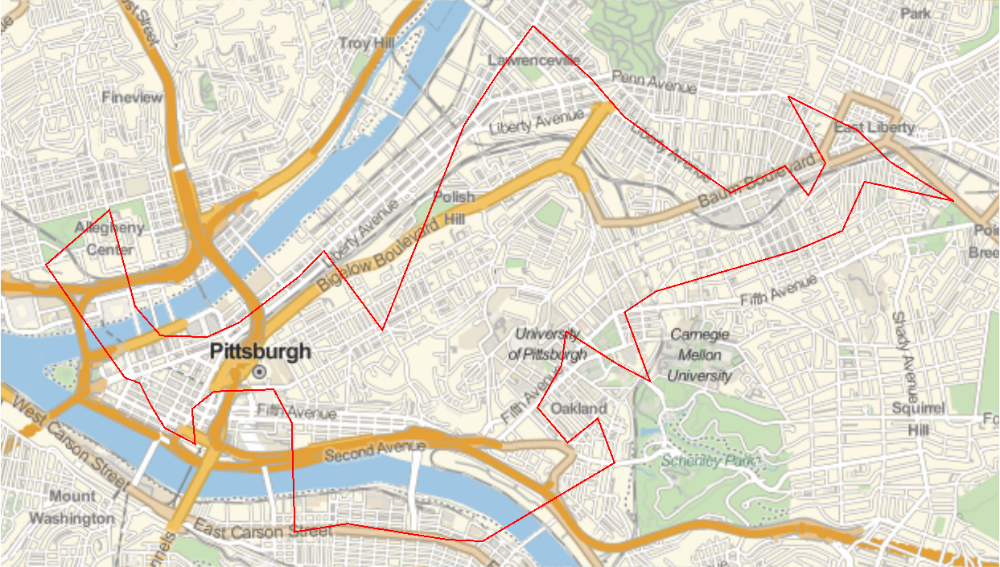
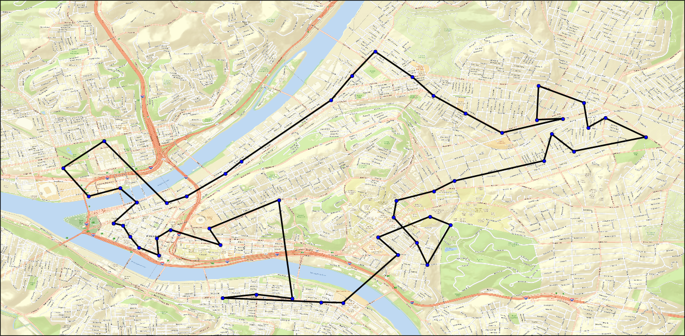
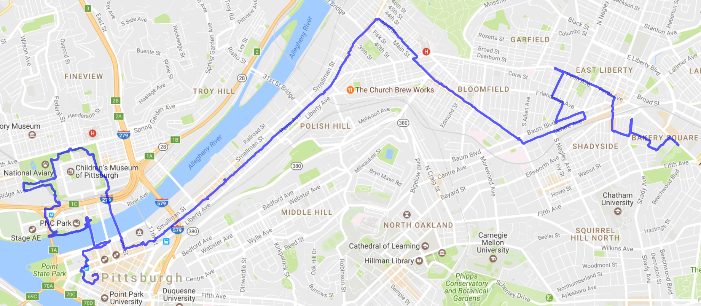
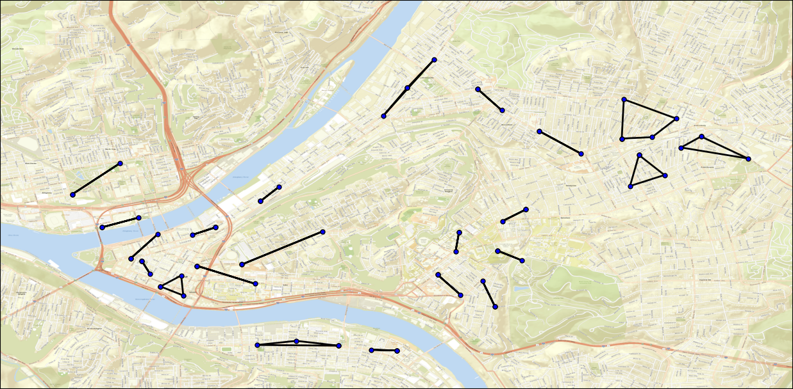
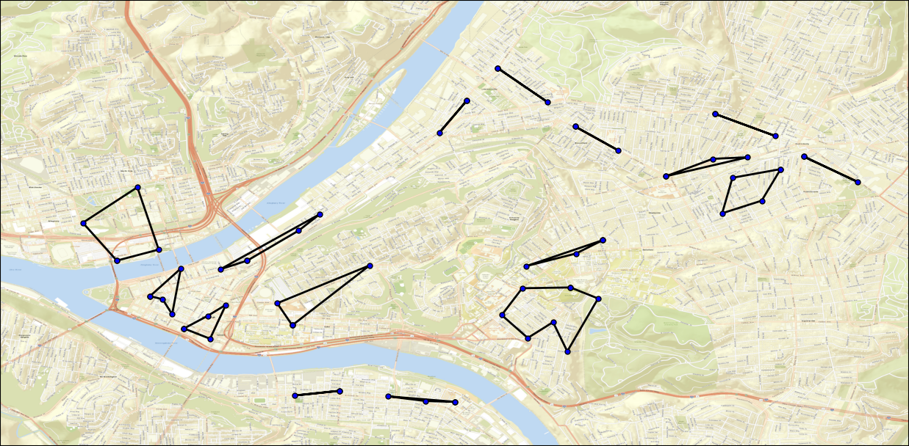
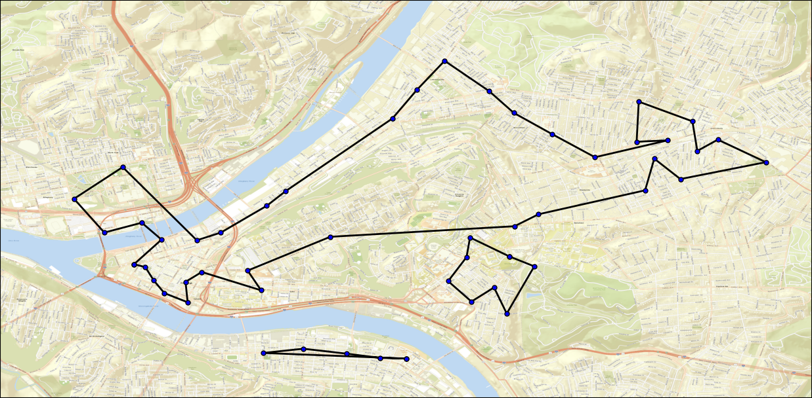
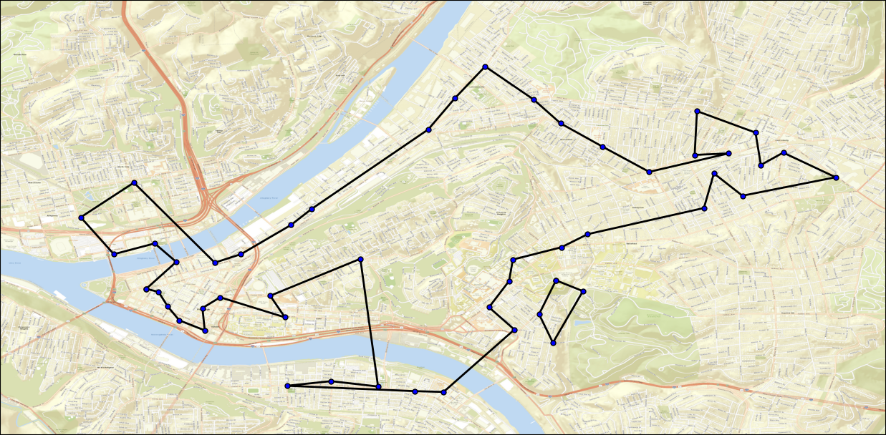
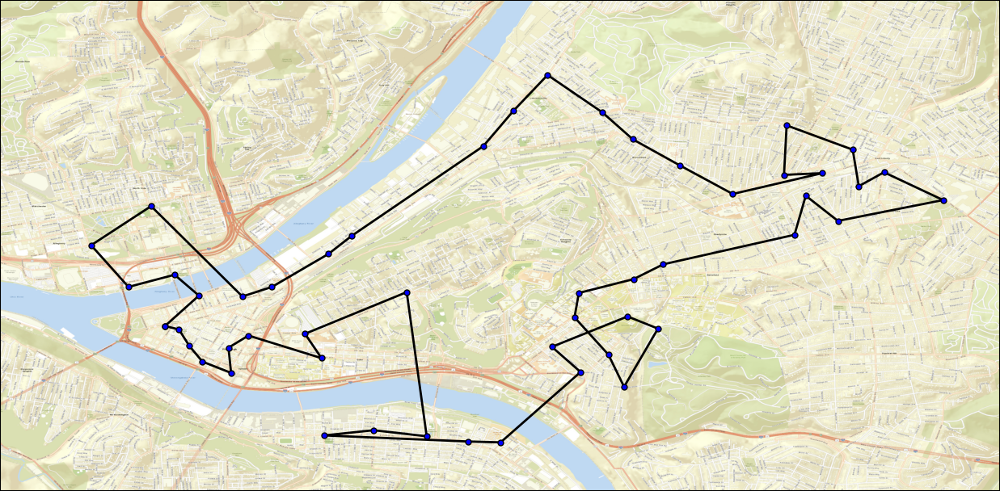

# Pittsburgh HealthyRide Stations Tour

## Motivation
There are 51 HealthyRide stations in Pittsburgh which seems like a reasonable number to ride a bike between in a day. What would be the shortest tour stopping once at each station and ending at the initial station?

## Station Locations
The first step is finding the coordinates of each station. This was accomplished easily by running the following JavaScript code on [this webpage](https://iframe.nextbike.net/reservation/?lat=40.4313684&lng=-79.9805005&zoom=12&height=400&maponly=1&language=en):
```javascript
for (var i = 0; i < stations.length; i++) {
    if (stations[i].city_uid == 254) {
        console.log(stations[i].lat + "," + stations[i].lng);
    }
}
```
These coordinates can be found in `data/nodes.csv`.

## Mathematica
A [reasonable](https://en.wikipedia.org/wiki/Travelling_salesman_problem#Computing_a_solution) shortest tour can be trivially obtained via Mathematica using the following code:
```mathematica
positions = {GeoPosition[{40.445834,-80.008882}],...,GeoPosition[{40.462025604284,-79.968114495277}]}
tour = Last[FindShortestTour[positions]]
GeoGraphics[{Thick, Red, Line[positions[[tour]]]}]
```
This produces the following tour:

This tour has a travel time of 3 hours 37 minutes 19 seconds, traversing counterclockwise a distance of 29.5 miles.

## Google Maps
The problem with this solution is that it uses an oversimplified model of the world. This isn't a flight path; the roads and bridges are of significance. Fortunately, the Google Maps [Distance Matrix API](https://developers.google.com/maps/documentation/distance-matrix/start) provides accurate biking times between points. The code in `scripts/distances.py` queries Google Maps to obtain the biking distance and duration for every possible pair of stations (2550 combinations altogether). These can be found in `data/costs.csv`.

## Simulated Annealing
Coercing Mathematica to use these values as edge weights was beyond my skills, so instead I wrote this program which uses [simulated annealing](https://en.wikipedia.org/wiki/Simulated_annealing) to obtain the solution. Simulated annealing can't guarantee an optimal solution, but it does a pretty good job nonetheless. The result is difficult to visualize, so I wrote `scripts/mapper.py` to print a map. Here is the best tour I was able to find:

Total travel time is 3 hours 5 minutes 29 seconds, traversing counterclockwise a distance of 26.7 miles.

## First Attempt
I attempted this tour on 2017-06-17 with the intent of renting a bike at each station and riding it to the next station. Unfortunately on six occasions the app told me the bike was rented, but the bike refused to unlock. This required me to call the service line to have them invalidate the rental and have me rent a different bike. At station 1014 I was unable to rent either the bike there or the one I had just returned, so I was forced to walk to station 1012. I threw in the towel at station 1001 after failing to rent a bike there and took a bus home. The attempt took me 2 hours and 45 minutes.


## Proof of Optimality
Contrary to my prior understanding, it's actually quite possible to find the optimal solution despite the fact that Traveling Salesman is an NP-complete problem. It turns out that if we relax the constraints of what constitutes a valid tour, we can set up a system of linear equations by assigning a variable to each edge and solve them using the [simplex algorithm](https://wikipedia.org/wiki/Simplex_algorithm).

The [DFJ formulation](https://wikipedia.org/wiki/Travelling_salesman_problem#Dantzig%E2%80%93Fulkerson%E2%80%93Johnson_formulation) has us start by restricting that the total number of edges entering each node must sum to 1, and the total number of edges leaving each node must also sum to 1. These correspond to a relaxed version of the actual problem, since it allows for disjointed subtours to form. Nonetheless, it gives us a strict lower bound on the optimal tour length. This means that if it produces a single contiguous tour, we can be certain that this is the global optimum.

Each time we encounter a disjointed subtour we can safely eliminate it by forcing the sum of all outbound edges from that subtour to sum to at least 1. Adding these subtour elimination constraints allows us to gradually coerce the result into a valid tour while maintaining our lower bound.

The first iteration of DFJ with just the base constraints gives us the following 22 disjointed subtours:

The second iteration breaks up these subtours into 16 different disjointed subtours:

The third iteration further breaks them into just 3 different disjointed subtours:

The fourth iteration breaks those into 2 disjointed subtours:

And the fifth iteration produces the optimal tour:


It turns out that the result found using simulated annealing was the optimum tour after all.
